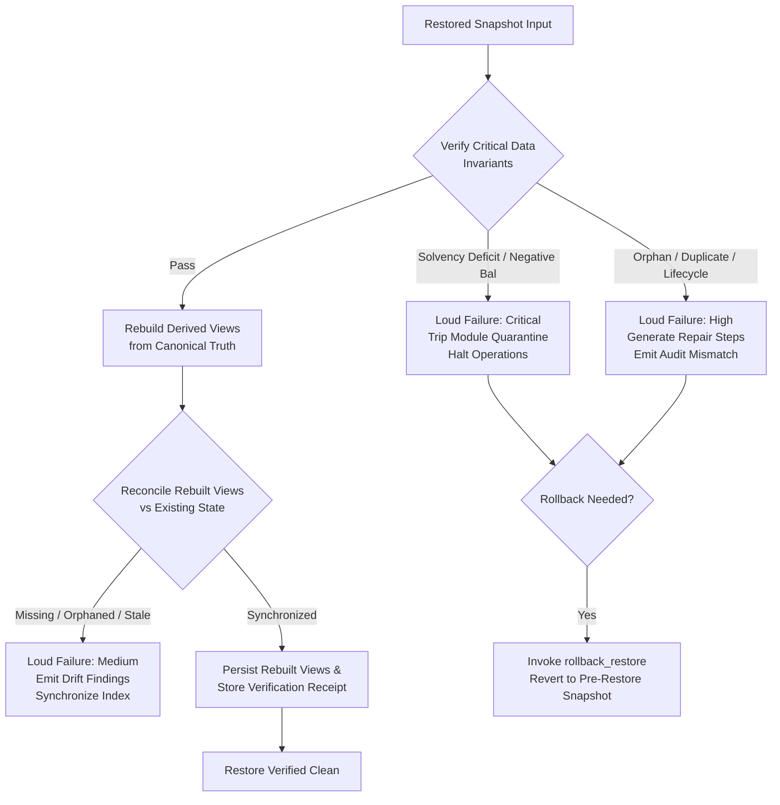

# Snapshot Restore Verification for Critical Data and Derived Indexes

## Overview

In the Trellis Soroban contract ecosystem — spanning **Treasury**, **Aid**, **Referral**, **Governance**, **Oracle**, and **Marketplace** — state restores occur during disaster recovery, historical audits, database restores, or rollback after an interrupted migration.

Restoring raw state records introduces two major categories of operational failure if left unverified:
1. **Critical Data Invariant Breaches**: State records may be corrupted, truncated, unbalanced, or orphaned (e.g. treasury reserve balance falling below internal liabilities, negative account balances, unlinked aid claims, or circular referral loops).
2. **Derived View / Secondary Index Desynchronization**: Secondary indexes (e.g., aid discovery search indexes, active governance proposals, strategy lists, marketplace listing registries) and cached aggregations (e.g., category reserve totals, vote tallies, floor prices) can diverge from canonical records or be omitted entirely from raw snapshots, leading to phantom listings, incorrect vote counts, or failed queries.

`shared::snapshot_restore` provides a vertical slice that executes **formal invariant verification on restored critical data**, **deterministically rebuilds derived secondary views**, **fails loudly on mismatches with concrete remediation steps**, and **retains deterministic rollback snapshots for automated recovery**.

---

## Architecture & Verification Workflow



---

## 1. Core Module Scopes & Restored Catalog

| Module | Critical Authoritative Data | Derived Secondary Indexes | Cached Projections | Invariant Focus |
|---|---|---|---|---|
| **Treasury** | Token vault reserve, internal liabilities, category allocations | Whitelisted Strategy Index (`strat_idx`) | Category Reserve Cache (`cat_bal`) | Solvency Equivalence ($B_{\text{reserve}} \ge L_{\text{liabilities}}$), non-negative balances |
| **Aid** | Aid disbursements, milestone tranches, claim links | Discovery Search Index (`search`), Donor Index (`donor_aid`) | Total pledged & distributed | Relational integrity (claims &rarr; aids), uniqueness |
| **Referral** | Partner relationship edges, commission rates | Downline / Upline Tree Index (`downline`) | Accrued Commission Cache (`comm_acc`) | No orphaned uplines, rate $\le 10,000$ bps |
| **Governance** | Proposals, ballots, quorum configurations | Active Proposals Index (`act_prop`) | Vote Tallies (`tally_for`, `tally_agt`) | Ballot validity, status consistency with tallies |
| **Oracle** | Price feed configs, authorized signers, price rounds | Registered Feeds Index (`feed_reg`) | Latest Price Round Cache (`price_rnd`) | Quorum threshold $\ge 1$, timestamp validity |
| **Marketplace** | NFT listings, escrow commitments | Active Collection Listings (`listing`) | Collection Floor Price Cache (`floor_p`) | Escrows link to open listings, floor = $\min(\text{asks})$ |

---

## 2. Restore Invariants

The framework enforces 5 invariant classes that must strictly hold after any snapshot restore:

### 2.1 Solvency & Asset Conservation Axiom
The physical token reserve held in the SAC token vault must match or exceed total internal ledger liabilities:
$$B_{\text{reserve}} \ge L_{\text{liabilities}}$$
Individual account, category, and commission balances must never be negative ($\forall B_i \ge 0$). Any violation is classified as **`Severity::Critical`** and triggers immediate module quarantine.

### 2.2 Relational Integrity (No Orphaned Records)
Every dependent child record must point to a valid, existing parent entity:
- Aid claims (`AidClaim`) must reference an existing `AidRecord`.
- Referral edges (`ReferralEdge`) with non-zero parent IDs must reference an existing partner.
- Governance ballots (`GovernanceBallot`) must reference an existing `GovernanceProposal`.
- Marketplace escrows (`MarketplaceEscrow`) must link to an active `MarketplaceListing`.

### 2.3 Uniqueness Constraints
No entity primary keys, idempotency tokens, or settlement receipts may collide or duplicate. Duplicate entries within the same entity scope trigger **`RestoreVerificationFailure::DuplicateRecordKey`**.

### 2.4 Lifecycle State Consistency
Entity statuses must be legal enum variants and aligned with observed parameters:
- Expired aids or proposals cannot be marked `Active`.
- Executed or cancelled proposals cannot accept new ballots.
- Sold marketplace listings cannot retain active buyer escrows.

### 2.5 Boundary & Quorum Thresholds
- Referral commission rates must be $\le 10,000$ basis points ($100\%$).
- Oracle price feeds must require a minimum quorum $\ge 1$ signer.

---

## 3. Derived View Rebuilding Specifications

Derived indexes and caches are reconstructed deterministically from authoritative canonical records:

```rust
// In shared::snapshot_restore:
let rebuilt_views = rebuild_derived_views(&env, module, &canonical_records);
```

1. **Treasury**:
   - `strat_idx`: Rebuilt from all `TreasuryStrategy` records marked `active`.
   - `cat_bal`: Computed by aggregating all `TreasuryBalance` amounts grouped by category symbol (`reserve`, `rewards`, custom).
2. **Aid**:
   - `search`: Filtered to only `AidRecord` entries where `status == symbol_short!("active")`.
   - `donor_aid`: Keyed by donor symbol to maintain complete participant index.
3. **Referral**:
   - `downline`: Rebuilt from canonical `ReferralEdge` records.
   - `comm_acc`: Aggregated per partner from `ReferralCommission` records.
4. **Governance**:
   - `act_prop`: Formed from `GovernanceProposal` entries where `status == symbol_short!("active")`.
   - `tally_for` and `tally_agt`: Computed from individual `GovernanceBallot` records.
5. **Oracle**:
   - `feed_reg`: Registered feed IDs with active status.
   - `price_rnd`: Latest sequential price round attestations.
6. **Marketplace**:
   - `listing`: Filtered to open listings (`status == symbol_short!("open")`).
   - `floor_p`: Calculated as the minimum ask price across all open listings in the collection.

---

## 4. Loud Failure Taxonomy & Actionable Repair Steps

When an invariant is breached or a derived view diverges, the system fails loudly with structured diagnostics containing exact expected values, actual observed values, severity, and copy-pasteable operator repair steps:

| Failure Kind | Severity | Condition | Failure Message | Prescriptive Repair Steps |
|---|---|---|---|---|
| **`SolvencyDeficit`** | `Critical` | $B_{\text{reserve}} < L_{\text{liabilities}}$ | Contract reserve is strictly less than internal liabilities | **CRITICAL**: Halt trading via emergency circuit breaker. Deficit detected. Reconcile physical SAC token reserves against internal liabilities. Do NOT manufacture artificial credit. |
| **`NegativeBalance`** | `Critical` | Record amount $< 0$ | Negative balance detected on critical financial record | **CRITICAL**: Halt contract operations. Investigate accounting journal and deposit/withdraw history. Review arithmetic overflow logs. |
| **`OrphanedRecord`** | `High` | Parent ID missing from state | Child record references non-existent parent entity | Run relational backfill tool: `./scripts/backfill.sh --module <mod> --input <file>`. Restore missing parent entity before reprocessing. |
| **`DuplicateRecordKey`** | `High` | Duplicate record ID | Duplicate primary key collision detected in restored snapshot | Halt batch processing. Perform manual deduplication runbook: see `docs/RESTORE_VALIDATION.md` for conflict resolution. |
| **`LifecycleInconsistency`**| `High` | Illegal status variant | Entity has unrecognized or invalid lifecycle status | Advance or reset proposal state machine to a valid variant (`active`, `executed`, `cancelled`, `defeated`) via lifecycle entrypoint. |
| **`BoundaryExceeded`** | `High` | Rate $> 10,000$ bps | Commission rate exceeds maximum allowable 10,000 basis points | Clamp commission rate to maximum permitted bounds via admin multisig proposal before resuming. |
| **`QuorumViolation`** | `High` | Quorum $< 1$ | Oracle price feed quorum requirement is zero | Re-initialize oracle feed quorum to configured minimum threshold in `docs/CONFIGURATION.md`. |
| **`DerivedViewDrift`** | `Medium` | Cache or index mismatch | Cached projection or secondary index diverges from canonical records | Synchronize projection: invoke `rebuild_derived_views` or run background repair worker `./scripts/run-worker.sh --job projection_repair`. |

---

## 5. Operational Edge Cases & Failure Modes

### 5.1 Concurrent Writes During Restore and Rebuilding
- **Risk**: User transactions mutate state while derived views are being reconstructed, resulting in a race condition where new mutations are overwritten by the restore rebuild.
- **Mitigation**: Operators must verify the restore under an active pause scope (`shared::auth::is_paused`). The verification checks compare ledger sequences and reject mutations if the ledger advances during a non-dry-run rebuild.

### 5.2 Storage TTL Expiration and Archived Records
- **Risk**: Restored records whose instance or persistent TTL lapsed on the network are archived, returning `NotFound` on standard lookups.
- **Mitigation**: Critical invariant checks use `shared::storage::persistent_get_required`. Archived records fail loudly with `NotFound` rather than defaulting to zero, prompting operators to run `RestoreFootprint` before completing restore validation.

### 5.3 Partial Failure in Multi-Entity Batch Restore
- **Risk**: A multi-record restore transaction runs out of gas or aborts midway, leaving dependent tables in an inconsistent partial state.
- **Mitigation**: All rebuild and restore executions record a pre-restore `RestoreRollbackSnapshot`. In the event of a partial failure, the transaction reverts atomically in Soroban host environment.

### 5.4 Arithmetic Underflow / Overflow
- **Risk**: Aggregating large category balances or ballot counts causes integer overflow.
- **Mitigation**: All arithmetic in `snapshot_restore` uses checked and saturating operations (`saturating_add`, `saturating_sub`). Any overflow attempts fail loudly with `SnapshotRestoreError::InvalidArgument`.

---

## 6. Rollback & Recovery Runbook

If restore verification detects invariant violations or downstream smoke tests reject the state, operators execute the following recovery protocol:

### Step 1: Dry-Run Preview
Always preview the restore before committing state changes:
```rust
let report = execute_restore_verification_and_rebuild(
    &env,
    RestoreModule::Treasury,
    &canonical_records,
    &existing_derived_views,
    true,  // dry_run: makes no state mutations
    false, // strict_mode
)?;
```

### Step 2: In-Place Execution & Receipt Generation
When dry-run report shows clean invariants (`report.receipt.passed == true`):
```rust
let report = execute_restore_verification_and_rebuild(
    &env,
    RestoreModule::Treasury,
    &canonical_records,
    &existing_derived_views,
    false, // commit writes
    true,  // strict_mode: aborts on Critical violations
)?;
let receipt_id = report.receipt.receipt_id;
```

### Step 3: Emergency Rollback Execution
If post-restore verification reveals unexpected regressions:
```rust
let rollback_receipt = rollback_restore(&env, receipt_id)?;
```
1. Retrieves the original derived views from `RestoreStorageKey::RollbackSnapshot(receipt_id)`.
2. Restores secondary indices and caches to their exact pre-verification state.
3. Automatically clears any active quarantine flags tripped by the failed restore.
4. Marks the rollback snapshot as applied, preventing double-rollback.
5. Emits `("snap_rst", "rollback")` event for observability and audit logging.

---

## 7. Automated Verification & Diagnostic Tooling

The verification suite is executable locally via Node.js and Bash:

```bash
# Executable verification test runner
node scripts/verify-snapshot-restore.cjs

# Read-only restore diagnostic script
./scripts/validate-restore.sh [--json]
```

All 7 test suites validate:
1. Treasury solvency invariant and derived view rebuilding.
2. Solvency deficit and negative balance loud mismatch reporting.
3. Aid relational integrity and discovery search index reconstruction.
4. Referral downline tree and accrued commission aggregation.
5. Governance active proposals filtering and ballot tally aggregation.
6. Oracle feed quorum and marketplace floor price calculation.
7. Derived view drift detection and pre-restore rollback execution.

---

## 8. Compatibility & Migration Notes

- **Zero Breaking Changes**: `shared::snapshot_restore` is purely additive. Existing contracts, public entrypoints, and schemas remain 100% backward compatible.
- **Storage Isolation**: Uses dedicated keys under `RestoreStorageKey`, avoiding collision with existing `shared::snapshot`, `shared::projection_repair`, or contract instance keys.
- **Re-exports**: Re-exported at `shared` crate root for ergonomic integration across test harnesses, diagnostic CLIs, and contract entry points.
